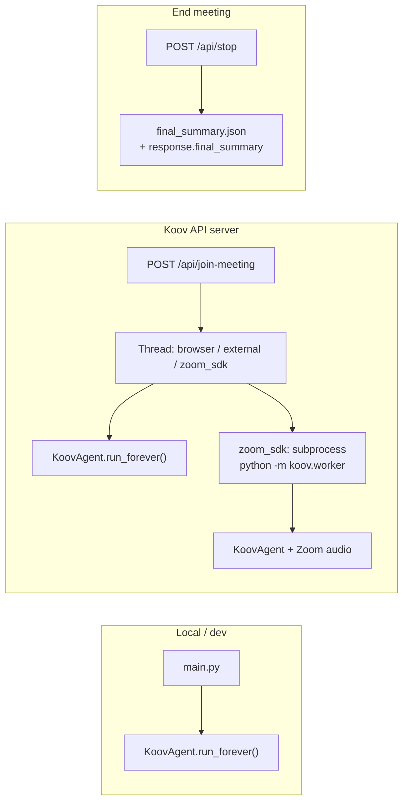
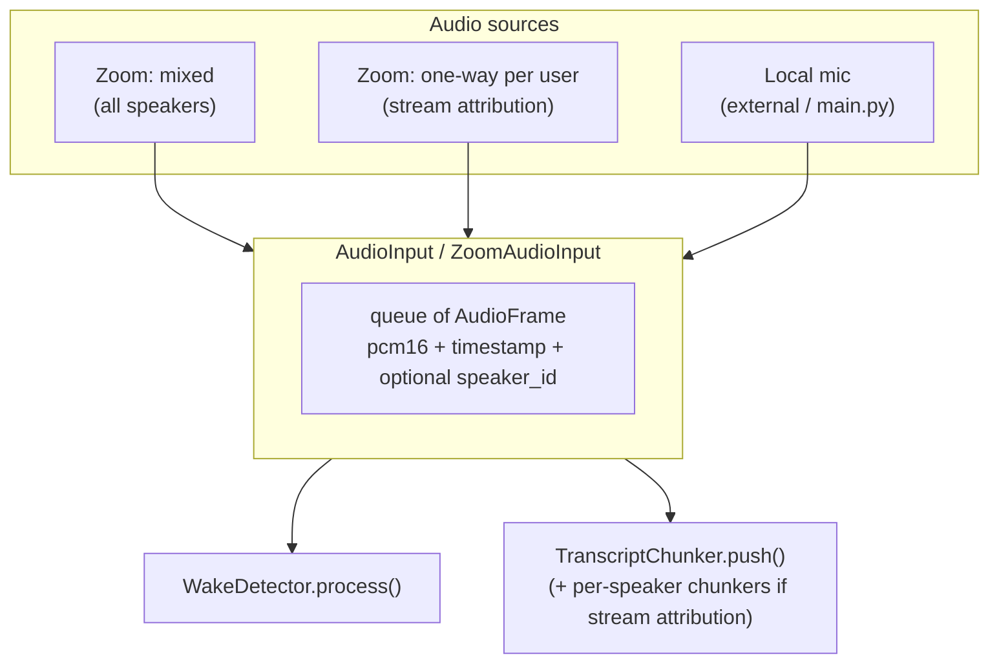
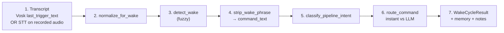
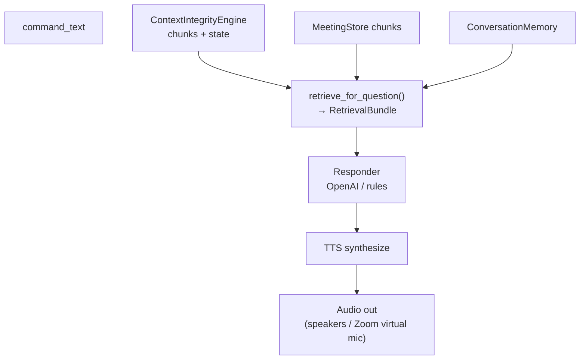
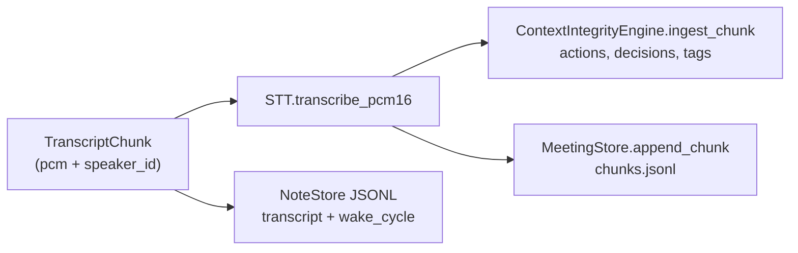
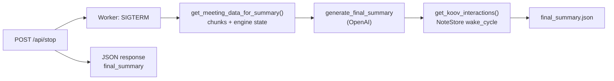

# Koov — how it works (architecture map)

This document maps **processes**, **data flow**, and **where configuration applies**. Use it with [ZOOM_SPEAKER_ATTRIBUTION.md](ZOOM_SPEAKER_ATTRIBUTION.md) for Zoom-specific paths.

---

## 1. Entry points

| Path | What starts the agent |
|------|------------------------|
| `python main.py` | Direct run with mic/speaker from `.env`. |
| `POST /api/join-meeting` | API spawns agent thread or **worker** subprocess (`zoom_sdk`). |
| `koov.worker` | Zoom SDK join + agent (one process per meeting). |

---

## 2. Audio in → two parallel concerns

While the agent runs, **every PCM frame** from `audio_in.read()` feeds:

1. **Wake detector** (Vosk / openWakeWord) — “did someone say the wake phrase?”
2. **Transcript pipeline** (optional) — continuous meeting transcription.

| Mode | Env | What you get |
|------|-----|----------------|
| Default Zoom | `KOOV_ZOOM_STREAM_ATTRIBUTION=0` | **Mixed** audio — one stream, everyone; speaker often `unknown` unless diarization. |
| Per-participant | `KOOV_ZOOM_STREAM_ATTRIBUTION=1` | **One-way** only — each frame tagged with Zoom **display name** (or `user_<id>`). No mixed feed. |
| Diarization | `KOOV_DIARIZATION_ENABLED=1` and **no** stream attribution | **Mixed** audio split by pyannote → `SPEAKER_00`… |

Stream attribution and full pyannote diarization are **mutually exclusive** in code (stream attribution wins; diarizer is not used).

---

## 3. Wake → command → response (7-step pipeline)

When the wake detector fires, the agent runs **`_run_wake_cycle`**:

| Step | Module / role |
|------|----------------|
| 1 | Prefer **Vosk trigger text** (captured **before** `reset()`) so the full phrase isn’t lost. |
| 2–4 | `koov/wake_detector.py` |
| 5 | `koov/intent_classifier.py` → may delegate to `koov/intent.py` |
| 6 | `koov/command_router.py` — presence/greeting/stop → instant; else **responder** |
| 7 | Memory segment, `NoteStore` **wake_cycle**, optional meeting snapshot |

**STT for the user’s question** uses `KOOV_STT_BACKEND` (faster-whisper, OpenAI, ElevenLabs, etc.) — **not** the same as TTS. **TTS** (`KOOV_TTS_BACKEND`) only turns Koov’s reply into audio for the meeting.

---

## 4. LLM path (when routed to responder)

- **Retrieval** (`koov/retrieval.py`): intent classification, optional **light path** for `general` (skip heavy chunk retrieval).
- **Responder** (`koov/responder.py`): system prompt, meeting-only grounding, optional **structured state** (decisions, action items).
- **Response cache**: keyed by question similarity; cleared on `set_meeting`.

---

## 5. Meeting transcript → structured memory

- **Action items** are extracted in `context_integrity_engine.py` (regex + state).
- **Snapshots**: `MeetingStore.save_snapshot(engine)` after wake responses.

---

## 6. Dashboard / API touchpoints

| Need | HTTP | Notes |
|------|------|--------|
| Live status + recent transcript lines | `GET /api/status?meeting_id=` | `live_transcripts` (capped). |
| Full transcript while active | `GET /api/transcript?meeting_id=` | Requires active session. |
| Speaker label overrides | `POST /api/meeting/speakers` | Writes `speaker_maps/<safe_meeting_id>.json` under `KOOV_NOTES_DIR`. |
| End meeting + **executive summary** | `POST /api/stop` | Body includes **`final_summary`** (LLM + interactions). Worker writes `koov_meetings/<id>/final_summary.json`. |

Koov **does not push** to the dashboard; the app **polls** or reads the **stop response**.

---

## 7. End of meeting

---

## 8. File layout (persistence)

| Path | Purpose |
|------|---------|
| `koov_notes/<session>.jsonl` | Transcript notes + **wake_cycle** (user/Koov turns). |
| `koov_notes/worker-status-<meeting_id>.json` | Worker heartbeat, `transcript_path`. |
| `koov_notes/speaker_maps/<safe_meeting_id>.json` | Manual speaker aliases (legacy `speaker-map-<meeting_id>.json` in notes root is still read). |
| `koov_meetings/<meeting_id>/chunks.jsonl` | Meeting transcript chunks for replay/summary. |
| `koov_meetings/<meeting_id>/snapshot.json` | Structured state snapshot. |
| `koov_meetings/<meeting_id>/final_summary.json` | End-of-meeting **executive_summary**, action_items, **interactions**. |

---

## 9. Config cheat sheet

| Variable | Effect |
|----------|--------|
| `KOOV_WAKE_PHRASE` | Comma-separated wake words. |
| `KOOV_STT_BACKEND` | Transcribes **user speech** (wake recording + transcript chunks). |
| `KOOV_TTS_BACKEND` | **ElevenLabs / Piper** — Koov’s **voice out** only. |
| `KOOV_ZOOM_STREAM_ATTRIBUTION` | Per-user Zoom streams + display names. |
| `KOOV_DIARIZATION_ENABLED` | Pyannote on **mixed** audio when stream attribution is off. |
| `KOOV_LLM_BACKEND` | OpenAI chat vs rules. |

---

*This map is a guide; see source under `koov/` for exact behavior.*
